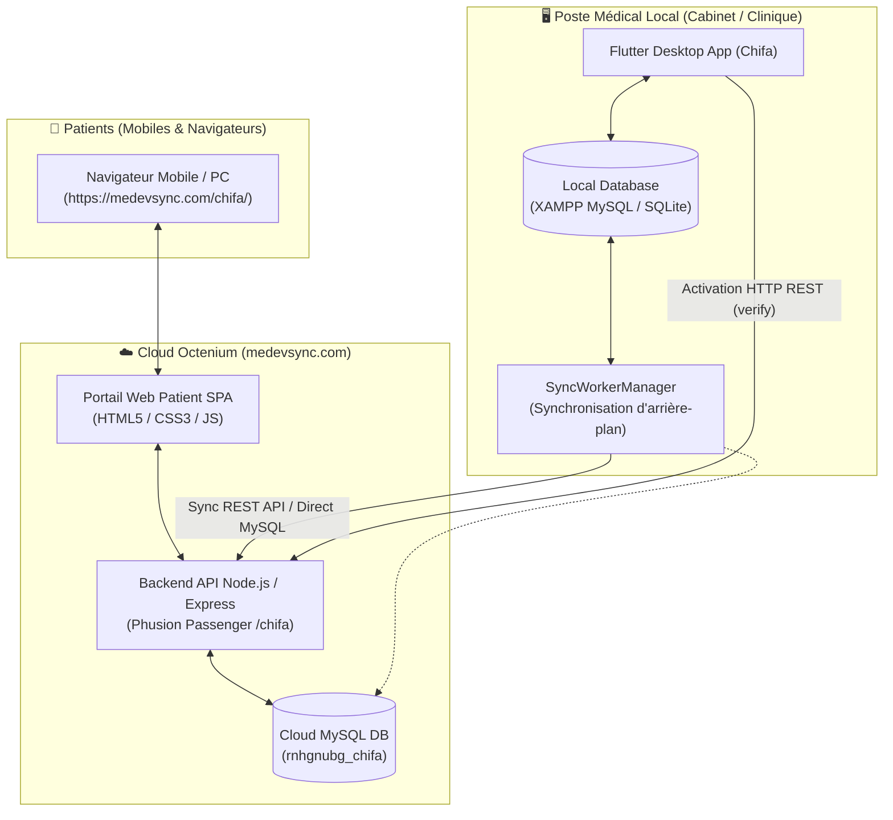
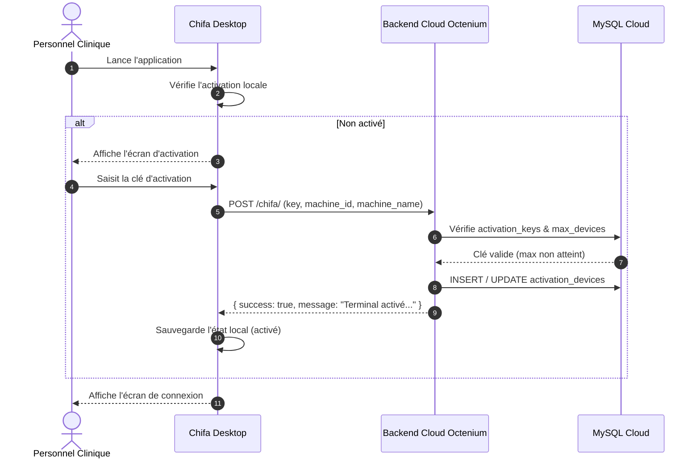
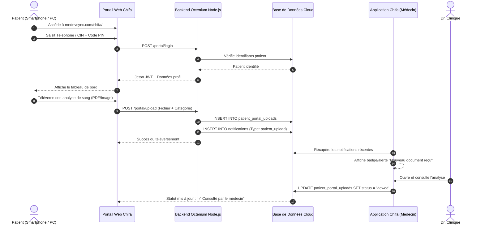

# 🏥 Chifa - Clinic Management System

**Chifa** est une solution complète de gestion de cabinet médical et de clinique, développée avec **Flutter** pour le poste client (Desktop Windows / Multiplateforme) et un **Backend Cloud Node.js (Express)** hébergé sur **Octenium**, connectée à une architecture de base de données hybride (Local MySQL / SQLite + Remote MySQL Cloud).

Elle intègre un **Portail Patient Web** sécurisé, un système d'**Activation Cloud des Postes**, une **Synchronisation bidirectionnelle des données**, ainsi que l'assistance à la prescription médicale (Vidal / Posologie / IA).

---

## 📑 Table des Matières

1. [Architecture Globale](#-architecture-globale)
2. [Workflows de l'Application](#-workflows-de-lapplication)
   - [1. Démarrage & Activation Cloud du Terminal](#1-démarrage--activation-cloud-du-terminal)
   - [2. Authentification & Gestion des Rôles](#2-authentification--gestion-des-rôles)
   - [3. Gestion des Patients & Dossier Médical (EHR)](#3-gestion-des-patients--dossier-médical-ehr)
   - [4. Consultations, Ordonnances & Bilan](#4-consultations-ordonnances--bilan)
   - [5. Facturation, Soins & Gestion d'Inventaire](#5-facturation-soins--gestion-dinventaire)
   - [6. Synchronisation Hybride (Local ⇄ Cloud Octenium)](#6-synchronisation-hybride-local--cloud-octenium)
   - [7. Portail Patient Web Sécurisé & Téléversements](#7-portail-patient-web-sécurisé--téléversements)
   - [8. Impression & Cartes Médicales QR Code](#8-impression--cartes-médicales-qr-code)
3. [Structure du Projet](#-structure-du-projet)
4. [Schéma de la Base de Données](#-schéma-de-la-base-de-données)
5. [Guide de Déploiement & Configuration](#-guide-de-déploiement--configuration)
   - [Backend Cloud (cPanel Octenium)](#backend-cloud-cpanel-octenium)
   - [Client Desktop Flutter](#client-desktop-flutter)

---

## 🏛 Architecture Globale



---

## 🔄 Workflows de l'Application

### 1. Démarrage & Activation Cloud du Terminal
Avant la première utilisation sur un nouveau poste informatique, l'application verrouille l'accès jusqu'à l'activation légale de l'établissement :
1. **Vérification Locale** : `ActivationService` vérifie la présence d'une clé d'activation chiffrée dans `SharedPreferences`.
2. **Écran d'Activation** : Si le poste n'est pas activé, l'écran `ActivationScreen` s'affiche avec l'identifiant unique du terminal (`Machine ID` / Hostname).
3. **Validation Cloud HTTP** :
   - Requête `POST https://medevsync.com/chifa/` avec `{ "key": "CHIFA-CLINIC-2026-HQ", "machine_id": "...", "machine_name": "..." }`.
   - Le backend Node.js interroge la table `activation_keys` sur la base Octenium.
   - Si la clé est valide et que le quota d'appareils (`max_devices`) n'est pas dépassé, l'appareil est enregistré dans `activation_devices`.
4. **Déverrouillage** : L'état d'activation est sauvegardé localement et l'application bascule automatiquement vers l'écran de connexion.



---

### 2. Authentification & Gestion des Rôles
- **Connexion Sécurisée** : Les médecins, secrétaires et administrateurs se connectent via leur adresse email et mot de passe (hachage `bcrypt`).
- **Validation d'Approbation (`is_approved`)** : Lors de la création d'un nouveau compte employé, celui-ci doit être approuvé par l'administrateur de la clinique avant de pouvoir accéder aux dossiers médicaux.
- **Rôles Applicatifs** :
  - **Médecin (Doctor)** : Accès complet aux consultations, prescriptions, dossiers médicaux, antécédents, certificats et documents uploadés par les patients.
  - **Secrétaire (Secretary)** : Gestion des rendez-vous, accueil des patients, facturation, encaissements et impression des cartes médicales.
  - **Administrateur (Admin)** : Gestion des employés, approbation des comptes, configuration des clés d'activation et suivi de la synchronisation.

---

### 3. Gestion des Patients & Dossier Médical (EHR)
- **Fiche Patient Centralisée** : Identité complète (Nom, Prénom, Date de naissance, CIN, Téléphone, Groupe Sanguin, Adresse).
- **Génération de Code Secret (PIN)** : Attribué au patient lors de sa création pour lui permettre de se connecter à son Espace Patient en ligne.
- **Dossier Médical Informatisé** :
  - Antécédents médicaux, chirurgicaux et familiaux.
  - Allergies et intolérances médicamenteuses.
  - Historique chronologique de l'ensemble des consultations et actes médicaux.

---

### 4. Consultations, Ordonnances & Bilan
- **Prise de Rendez-vous** :
  - Calendrier interactif avec vue par médecin et par statut (*En attente*, *Confirmé*, *Terminé*, *Annulé*).
- **Rédaction d'Ordonnance Assistée** :
  - Base de données médicamenteuse intégrée (**Vidal**).
  - Suggestions automatiques de posologie (`posology_service`).
  - Vérification des interactions et aide à la recherche intelligente.
- **Certificats Médicaux** :
  - Génération normalisée : Arrêt de travail, Certificat de bonne santé, Certificat prénuptial, Certificat de coups et blessures, Dispense de sport.
- **Bilans Médicaux** :
  - Prescriptions d'analyses biologiques et radiologiques préconfigurées.

---

### 5. Facturation, Soins & Gestion d'Inventaire
- **Actes & Soins Médicaux** : Catalogue des prestations avec tarifs et cotations.
- **Facturation & Règlements** :
  - Génération de factures patients (`invoices`), encaissement des paiements (`payments`), gestion des remises et reste à payer.
- **Gestion de Stock / Inventaire** :
  - Suivi des consommables et médicaments de la clinique (`inventory_items`).
  - Alertes automatiques en cas de stock critique ou de péremption.

---

### 6. Synchronisation Hybride (Local ⇄ Cloud Octenium)
Chifa combine le meilleur des deux mondes : **vitesse instantanée en local** et **accessibilité globale sur le Cloud**.

1. **Fonctionnement Hors-Ligne (Offline-First)** :
   - Toutes les écritures (nouveau patient, ordonnance, paiement) s'effectuent immédiatement sur la base de données locale (XAMPP MySQL ou SQLite local).
   - Aucune latence réseau pour le médecin lors de sa consultation.
2. **Travailleur d'Arrière-Plan (`SyncWorkerManager`)** :
   - Tourne en tâche de fond à intervalle régulier.
   - Détecte les modifications locales récentes via les horodatages `updated_at` / `created_at`.
   - Transmet les deltas vers la base de données Cloud Octenium (`rnhgnubg_chifa`).
3. **Récupération des Événements Distants** :
   - Télécharge les nouveaux rendez-vous demandés en ligne par les patients.
   - Synchronise les statuts des téléversements de documents.

---

### 7. Portail Patient Web Sécurisé & Téléversements
Accessible depuis n'importe quel smartphone ou ordinateur sans aucune installation :
- **URL** : `https://medevsync.com/chifa/` (ou `https://medevsync.com/chifa/portal`)
- **Authentification Patient** :
  - Identifiant : **Numéro de Téléphone** ou **CIN**
  - Code Secret : **Code PIN** (ou Date de naissance)
- **Fonctionnalités Disponibles pour le Patient** :
  - 📋 **Historique des Ordonnances** : Consultation des prescriptions délivrées par la clinique.
  - 📅 **Rendez-vous** : Suivi des consultations passées et à venir, avec possibilité de demander un nouveau rendez-vous.
  - 📤 **Téléversement de Documents** :
    - Envoi direct de bilans sanguins, comptes rendus d'analyses ou clichés radiologiques (JPG, PNG, PDF).
    - Ajout d'une note explicative pour le praticien.
  - 🔔 **Notification Automatique au Cabinet** :
    - Dès qu'un patient envoie un fichier, une entrée est insérée dans la table `notifications`.
    - L'application Flutter du médecin affiche une notification en temps réel pour l'avertir.
    - Le médecin consulte le document et le marque comme *« Consulté »*, informant instantanément le patient sur son espace.



---

### 8. Impression & Cartes Médicales QR Code
- **Cartes Médicales Patients PVC** :
  - Impression au format carte bancaire (CR80) avec les informations d'urgence du patient et son groupe sanguin.
  - Impression d'un **QR Code sécurisé** menant directement au portail web :
    `https://medevsync.com/chifa/?patient_id=...`
  - Permet au patient de scanner sa carte avec son téléphone pour accéder instantanément à son espace.
- **Documents Médicaux Haute Définition** :
  - Ordonnances au format A4 / A5 avec en-tête personnalisable de la clinique.
  - Factures et reçus de paiement avec détails des actes.
  - Certificats médicaux officiels prêts à être signés.

---

## 📂 Structure du Projet

```text
chifa_app/
├── backend/                       # Backend Cloud Node.js (Octenium)
│   ├── routes/
│   │   ├── activation.js          # Vérification & gestion des clés de licence
│   │   ├── auth.js                # Authentification des employés
│   │   ├── portal.js              # API du portail patient (login, uploads, rdv)
│   │   ├── sync.js                # Endpoints de synchronisation bidirectionnelle
│   │   └── notifications.js       # Notifications d'uploads en temps réel
│   ├── public/portal/             # Application Web Single Page (Portail Patient)
│   │   ├── index.html             # Page web responsive
│   │   ├── style.css              # Design médical moderne (Material/Tailwind-like)
│   │   └── app.js                 # Logique client & appels API résilients
│   ├── scripts/                   # Scripts de migration, tests & build
│   │   ├── build_zip.js           # Générateur de l'archive de déploiement cPanel
│   │   ├── bundle_portal.js       # Inliner des assets du portail
│   │   └── run_live_migrations.js # Migrations SQL sur Octenium
│   ├── server.js                  # Point d'entrée Express & multi-routing Passenger
│   ├── db.js                      # Pool de connexions MySQL2
│   ├── .env                       # Configuration environnement Cloud
│   └── chifa-backend-octenium.zip # Archive prête à extraire sur cPanel
│
├── lib/                           # Application Flutter Desktop & Multiplateforme
│   ├── app/
│   │   ├── cubits/                # Gestion d'état BLoC/Cubit (Auth, Patient, RDV...)
│   │   ├── screens/               # Écrans de l'interface graphique
│   │   │   ├── auth/              # Connexion, inscription & contrôle activation
│   │   │   ├── dashboard/         # Tableau de bord principal de la clinique
│   │   │   ├── patients/          # Liste et création des patients
│   │   │   ├── medical_records/   # Dossiers médicaux & antécédents
│   │   │   ├── prescriptions/     # Rédaction et historique des ordonnances
│   │   │   ├── appointments/      # Gestion et calendrier des rendez-vous
│   │   │   └── billing/           # Facturation et encaissements
│   │   └── widgets/               # Composants réutilisables & dialogues
│   ├── presentation/features/
│   │   └── activation/            # Interface d'activation du poste
│   └── services/
│       ├── activation/            # ActivationService (HTTP Cloud API)
│       ├── db/                    # Couche données (DatabaseManager, SQLite, Sync)
│       │   ├── repositories/      # Repositories d'accès aux données
│       │   ├── sync_manager.dart  # Moteur de synchronisation
│       │   └── local_sqlite_service.dart # Base locale SQLite de secours
│       ├── pdf_generation_service.dart # Génération des ordonnances et cartes
│       ├── vidal/                 # Assistance médicamenteuse Vidal
│       └── xampp_service.dart     # Contrôle automatique du service MySQL local
└── README.md                      # Documentation du projet
```

---

## 🗄 Schéma de la Base de Données

Les tables principales synchronisées entre le local et le Cloud :

| Table | Description |
| :--- | :--- |
| `activation_keys` | Clés de licence de l'établissement (quota de terminaux, validité) |
| `activation_devices` | Terminaux activés (Machine ID, hostname, adresse IP, dernière connexion) |
| `users` | Comptes des employés (médecins, secrétaires, administrateurs, approbation) |
| `patients` | Registre des patients (nom, prénom, date de naissance, téléphone, CIN, code PIN) |
| `medical_records` | Dossiers médicaux, consultations, diagnostics et antécédents |
| `appointments` | Rendez-vous médicaux avec praticien assigné et statut |
| `prescriptions` | Ordonnances médicales et posologies prescrites |
| `invoices` & `payments` | Facturation de la clinique et règlements enregistrés |
| `patient_portal_uploads` | Fichiers d'analyses et radios téléversés en ligne par les patients |
| `notifications` | Alertes destinées à l'équipe médicale (nouveau fichier reçu) |
| `inventory_items` | Stock des médicaments et matériels médicaux |

---

## 🚀 Guide de Déploiement & Configuration

### Backend Cloud (cPanel Octenium)

1. **Configuration dans cPanel > Setup Node.js App** :
   - **Node.js version** : `24.x` (ou supérieure)
   - **Application mode** : `Production`
   - **Application root** : `chifa_backend`
   - **Application URL** : `medevsync.com` / `chifa`
   - **Application startup file** : `server.js`
2. **Déploiement des fichiers** :
   - Téléversez l'archive générée `backend/chifa-backend-octenium.zip` dans le dossier `chifa_backend/` sur cPanel et extrayez-la.
3. **Règle `.htaccess` (indispensable si MedInfect est à la racine)** :
   - Dans le fichier `public_html/.htaccess`, ajoutez juste après `RewriteEngine On` :
     ```apache
     RewriteRule ^chifa(/.*)?$ - [L]
     ```
4. **Redémarrage** :
   - Cliquez sur **« Restart »** dans l'interface cPanel Node.js.

### Client Desktop Flutter

1. **Configuration Locale & Exécution en Développement** :
   - Assurez-vous que XAMPP (MySQL) est démarré, ou laissez Chifa initialiser le mode local SQLite.
   ```bash
   flutter pub get
   flutter run -d windows
   ```
2. **Génération de l'Installateur Final Windows (Comme MedInfect)** :
   - Pour compiler le binaire Release et générer automatiquement l'installateur Inno Setup et l'archive ZIP :
   ```powershell
   powershell -ExecutionPolicy Bypass -File scripts\package_windows_app.ps1
   ```
   - Les fichiers générés sont placés dans le dossier [`deployment/`](file:///d:/DEV-FOLDER/FLUTTER/chifa_app/deployment) :
     - `Chifa_Setup_v1.0.0.exe` : Installateur professionnel autonome Inno Setup.
     - `Chifa_Windows_x64.zip` : Archive portable complète.
     - `windows/Chifa/` : Dossier binaire avec DLLs Microsoft CRT et raccourci bureau.
3. **Activation initiale** :
   - Saisissez la clé d'activation : `CHIFA-CLINIC-2026-HQ`.
   - Cliquez sur **« Activer ce terminal »**. La validation s'effectue automatiquement via l'API Cloud d'Octenium.

---

## 🔒 Sécurité & Confidentialité

- **Chiffrement des Données** : Les mots de passe et codes secrets sont hachés avec `bcrypt`.
- **Isolation des Sessions Patients** : Jetons JWT (JSON Web Tokens) signés côté serveur avec expiration.
- **Protection CORS & En-têtes HTTP** : Sécurisation via Helmet et filtrage des origines autorisées.
- **Résilience Réseau** : Capacité de fonctionnement 100% autonome hors-ligne en cas de coupure Internet, avec resynchronisation automatique dès le retour de la connexion.

---
*© 2026 Clinique Chifa — Système Intégré de Gestion Médicale.*
